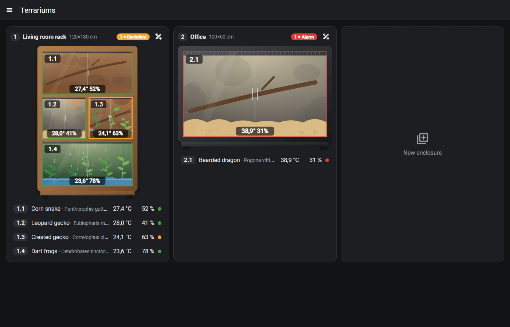
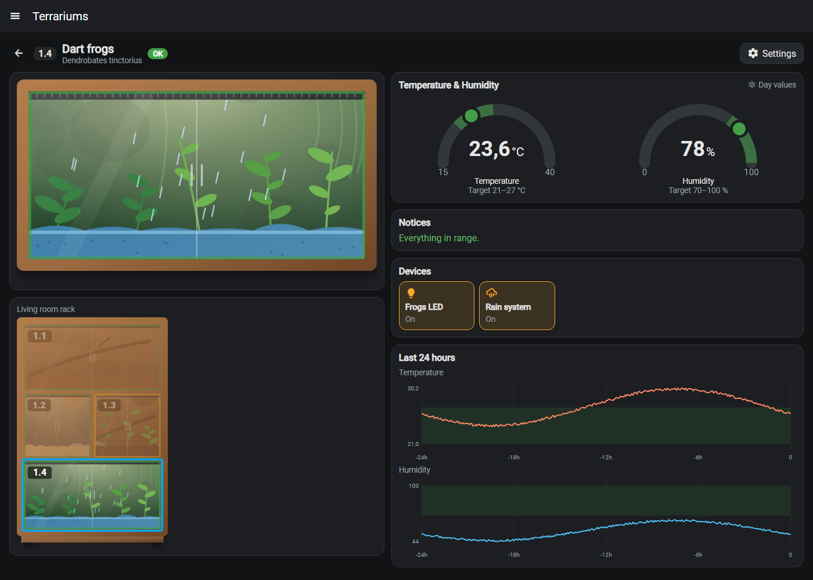
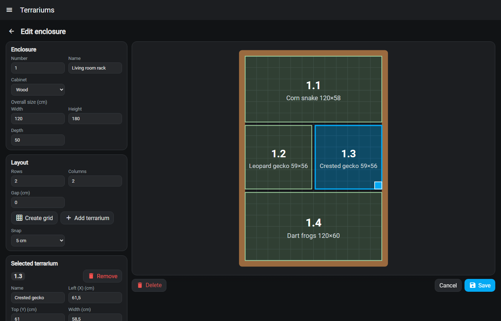

# Terrarium for Home Assistant



Manage terrariums for keeping animals in Home Assistant: build **enclosures** (racks, cabinets) that are split into
several **terrariums** of any size and position, watch **temperature and humidity** against limits and get
**push notifications** when something is out of range.

The integration brings its own **sidebar panel** (and a Lovelace card) with an overview of all terrariums, a drawn
**model** of every enclosure, a detail view per terrarium and all settings – no YAML needed.

## Features

- **Enclosures** with overall width, height and depth (cm) and a cabinet colour (wood, black, white, grey).
- **Terrariums inside an enclosure** – side by side, stacked, one on top and two below … any layout:
  - visual layout editor: drag to move, drag the corner to resize, snap to 0.5 / 1 / 2.5 / 5 / 10 cm,
  - grid generator (rows × columns × gap), exact numbers for X / Y / width / height / depth,
  - overlap and out-of-bounds check.
- **Automatic numbering** `<enclosure>.<terrarium>` – top to bottom, left to right (`1.1`, `1.2`, `1.3`, …).
  When the layout changes, the numbers and the entity ids follow (entity ids you renamed yourself are left alone).
- **Climate monitoring per terrarium**
  - one or more temperature and humidity sensors (several = average),
  - minimum / maximum, hysteresis, delay before notifying,
  - optional **night values** with their own time window.
- **Notifications** – to notify services (e.g. the companion app) and notify entities, optional all-clear,
  repeat interval, sensor failure, optional persistent HA notification, test button.
  Every alarm also fires the event `terrarium_alarm` for your own automations.
- **Devices per terrarium** (light, heat, UV, ventilation, rain, fogger, pump, other) that can be switched by hand
  in the detail view – and are shown in the model (light glow, heat spot, rain).
- **Model look** per terrarium: substrate (soil, sand, bark, moss, gravel, water part), decoration
  (plants, stones, branches, mixed) and back wall (rock, cork, plain, jungle).
- German and English.





## Planned

Light control (times, sunrise/sunset), ventilation control and rain simulation – the settings page already
has the places reserved for them.

## Installation

### HACS

1. HACS → ⋮ → *Custom repositories* → `https://github.com/SysriX/terrarium_ha_integration`, type *Integration*.
2. Install **Terrarium**, restart Home Assistant.
3. *Settings → Devices & services → Add integration → Terrarium*.

### Manual

Copy `custom_components/terrarium` to `<config>/custom_components/`, restart, add the integration.

The card script is loaded automatically – no dashboard resource needed.

## Usage

- Open **Terrarien / Terrariums** in the sidebar (title, icon and admin-only can be changed under
  *Configure* of the integration).
- **New enclosure** → overall size → split it (grid or *Add terrarium*) → *Save*.
- Tap a terrarium → detail view → **Settings** (sensors, limits, notifications, devices, look).

Editing needs an administrator; everybody can look and switch devices.

### Card

The same view as a card, e.g. on a wall tablet:

```yaml
type: custom:terrarium-card
title: Terrariums      # optional
enclosure: 1           # optional – only this enclosure
compartment: "1.2"     # optional – open this terrarium directly
```

## Entities

Per terrarium (`1_2` = terrarium 1.2):

| Entity | Description |
|---|---|
| `sensor.terrarium_1_2_temperature` | temperature (average of the chosen sensors), attributes `min`, `max` |
| `sensor.terrarium_1_2_humidity` | humidity, attributes `min`, `max` |
| `sensor.terrarium_1_2_status` | `ok`, `pending` (out of range, delay running), `alarm`, `offline`, `not_configured` |
| `binary_sensor.terrarium_1_2_problem` | on while an alarm is active |
| `switch.terrarium_1_2_cfg_notify` | notifications on/off |

Per enclosure: `sensor.terrarium_1_problems` – number of terrariums with an alarm.

### Event `terrarium_alarm`

```yaml
label: "1.2"
compartment: Leopard gecko
problem: temp_low        # temp_low, temp_high, hum_low, hum_high, offline
kind: start              # start, repeat, clear
value: 21.4
limit: 25
```

## WebSocket API

`terrarium/get`, `terrarium/subscribe`, `terrarium/save_enclosure`, `terrarium/delete_enclosure`,
`terrarium/save_compartment`, `terrarium/test_notify`, `terrarium/notify_targets`.
Data is stored in `.storage/terrarium`.

## License

MIT
